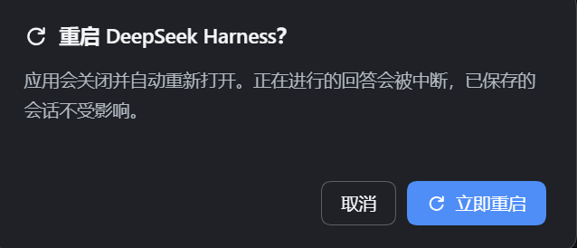

# dsh-quick-restart

**One-click restart plugin for the DeepSeek Harness desktop app (Windows).**

Adds a panel directly below the sidebar's 「插件」 (Plugins) entry: open it → restart the app in about **2 seconds**, with live status and the recent helper log. The same panel also carries a **one-click plugin control** card that turns every other plugin off and back on.

See the [Chinese README](README_ZH.md) for the full document (installation, architecture, troubleshooting).



## Features

- **Lives under 「插件」**: a `sidebar.panellist` row at order 1 (right below Plugins) addressing a `main` panel with status, the action and the log tail.
- One-click restart in ~2 s (an earlier PowerShell-based design took ~14 s).
- **One-click plugin control**: the same list as the sidebar's 「插件」 page — every installed plugin — with a per-row switch and "turn off every other plugin" / "restore all" buttons. All of it goes through the official `pluginManager`, which only unloads a bundle (never uninstalls it) and refuses to touch the core.
- **Protects the official upgrade**: refuses to force-restart while a genuinely newer update is downloaded and waiting, because only the official install flow can apply it.

## Why the entry moved (v0.4)

v0.3 registered into `sidebar.brand.name` with `priority: -1`. That slot is `kind: "single"` — exactly one live registration renders — so `-1` **shadowed the official wordmark cell** (`@deepseek-ai/dsh-client-ui-brand-official`, priority 0). Shadowing shipped UI for a button is needless risk; `sidebar.panellist` is the seat the shell documents for panel-selector rows (it draws the button, then `selectPanel(id)` opens the `main` panel whose `key` matches). v0.4 therefore uses `main` + `sidebar.panellist` and never touches the brand row.

## Why force-restart broke the official upgrade (fixed)

`DesktopUpdateCoordinator` sets:

```js
this.updater.autoDownload = false;
this.updater.autoInstallOnAppQuit = false;   // ← the key line
```

A downloaded update is therefore **never installed on quit**. The only install path is the in-app flow: `beforeRestart()` → `host.updateTasks("lock")` (from that moment every HTTP request answers a bare **503**) → close the window → `host.stop(true)` which **requires a clean Host exit** → `updater.quitAndInstall(true, true)`.

This plugin restarts with `taskkill /F /T`, which bypasses that entire flow, so:

- a pending update stays in `…\@deepseek-aidsh-desktop-updater\pending\` forever;
- a kill landing inside the official install window breaks the clean-exit contract → `stop-failed`, and the admission lock keeps answering 503 afterwards.

v0.4 guards all three layers:

| Layer | Behaviour |
| --- | --- |
| Node half | Reads `pending/update-info.json` and compares its version with the **installed** build (parsed from `<app>\resources\app.asar`); only a strictly newer pending version answers **409 `update-pending`** |
| Helper | Re-checks the marker immediately before killing (covers "confirmed, then the download finished"), and aborts instead of killing |
| Panel | Shows a warning and disables the button, pointing at the official install |

> **Fixed in v0.4.2**: `electron-updater` never deletes `pending\update-info.json` after a successful install, so "marker present" does not mean "update waiting". v0.4.0/v0.4.1 answered 409 on the bare file and left the button greyed out forever after an upgrade. The guard is now version-aware: `pending ≤ installed` is treated as a leftover (`status.pendingUpdate.stale === true`) and the restart is allowed.

> **Fixed in v0.4.8**: the button went permanently grey after the 0.2.1-rc.5 update even though rc.5 was already installed. `readAppVersion()` assumed the asar data section starts at `16 + headerSize` rounded up to an 8-byte boundary, but that padding belongs to the packer: rc.3's header happened to be 8-aligned (so the formula was accidentally right) while rc.5's is `headerSize % 8 === 4` and its data still starts at exactly `16 + headerSize`. Every read was 4 bytes off, `JSON.parse` failed, and the version silently became `null`. The reader now probes `16 + headerSize`, `8 + pickleLength` and a ±8 neighbourhood, taking the first base that yields a real version. `stale` also became tri-state — `true` leftover, `false` genuinely newer, `null` could-not-compare — and only `false` blocks a restart; `null` warns in the panel and the host log. A version we cannot read must never be able to brick the button.

Opt out (not recommended): `POST /quick-restart/api/restart` with `{"force":true}`.

## Finishing the Host's shutdown (v0.4.1)

The upgrade then failed one step later with:

```
Desktop update: Host did not complete graceful task teardown
(exit null, signal SIGTERM, shutdown acknowledged true, graceful deadline exceeded true)
```

`stop(requireGraceful)` sends `{type:"shutdown"}`, waits **10 s** for the child to exit, escalates to SIGTERM, and refuses the install when the exit was not clean. The Host does ack (`shutdown.shutdown(0)` → `shutdown-complete` → `process.disconnect()`), but Node only exits once the event loop drains — one ref'd timer or child stdio pipe from any plugin keeps it alive forever.

Measured attribution across the profile's 16 plugins with a `dsh` manifest (apply → dispose → count surviving handles and timer creation stacks):

| Plugin | Left after dispose |
| --- | --- |
| `billion-context` | **5 timers**, including `setInterval(10000) armRecoveryTimer`, `setTimeout(499) refreshTimeout`, `setTimeout(5000)` |
| `dsh-plugin-wallpaper-engine` | 2 timers (3000, `scheduleAdapterRestart` 30000) |
| `@liustack/modlens` | 1 timer (`scheduleRetry` 5000) |
| `@xmanrui/dsh-im` | 0 timers, 2 PipeWraps |
| **`dsh-quick-restart`** | **0** |

So this plugin is not what holds the Host open — but it runs inside that Host and can finish the job without touching third-party code:

```
process 'disconnect' (Host acked shutdown, IPC dropped)
  └─ log the resources still alive
  └─ arm one *unref'd* timer (default 2 s)
       ├─ loop drains   → the process already exited; the timer never fires
       └─ leaked handle → process.exit(0) inside the desktop's 10 s window
```

`exit 0` within 10 s satisfies `requireGraceful`, so the installer proceeds. Verified end to end: with a simulated 10 s interval leak the host path exits **code 0 at 2045 ms**; with a clean loop it exits on its own in **36 ms**.

## Install (Windows only)

```powershell
dsh plugin --profile desktop add dsh-quick-restart
```

## How it works

The web client posts to `/quick-restart/api/restart`. The Node half (a cordis plugin running in the DSH Host child process) writes a launcher script and asks WMI `Win32_Process.Create` to start a detached restart helper **outside the app's Job Object** (every DSH process sits in one, so a plainly spawned helper would die with the app). The helper — the Electron binary running in Node mode via `ELECTRON_RUN_AS_NODE=1` — force-kills every app process and relaunches the exe without that variable.

Key measured facts behind the design (details in source comments):

- Detached Windows PowerShell 5.1 exits silently without a console — it cannot be the restart vehicle.
- `taskkill`'s WM_CLOSE never terminates Electron children; a single `taskkill /F /T` over all PIDs is both correct and fastest.
- `ELECTRON_RUN_AS_NODE` must be stripped from the relaunch environment or the app boots as a headless Node process.

## HTTP API

| Method | Path | Purpose |
| --- | --- | --- |
| POST | `/quick-restart/api/restart` | Trigger the restart (`{ "dryRun": true }` rehearses; `{ "force": true }` bypasses the pending-update guard) |
| POST | `/quick-restart/api/status` | Status: exe path, helper presence, `pendingUpdate` |
| POST | `/quick-restart/api/logs` | Tails of the spawn, helper and launcher logs |
| POST | `/quick-restart/api/plugins` | Installed bundles: `name`, `enabled`, `removable`, `readOnlyReason`, `error`, `self`, plus counts |
| POST | `/quick-restart/api/set-plugin` | Switch one bundle: `{ "name": "dsh-better-sidebar", "enabled": false }` |
| POST | `/quick-restart/api/set-plugins` | Switch many at once: `{ "names": ["…"], "enabled": false }` (max 200 per call, applied strictly one at a time) |

Every `set-plugin*` call answers `200` and reports per-bundle outcomes in `value.applied` / `value.rejected` (`unknown-plugin`, `management-required`, `not-removable`, or the `ManagementFailure` code), with `value.partial: true` when some succeeded and some did not. A single bad name never half-applies a batch: every name is validated against the live bundle list **before** anything is written. `names` is the canonical field; `name`, `entryId` and `entryIds` are still accepted so an older cached client bundle keeps working.

## One-click plugin control (v0.4.6)

The panel's second card lists the profile's **installed plugins** — exactly what the sidebar's 「插件」 page shows — and offers a per-row toggle plus two bulk actions: **Turn off the other plugins (N)** and **Restore all (N)**.

These are *bundles*: packages recorded in the profile's `dependencies`. Switching one off removes its name from `dsh.profile.bundles`, so it simply stops being loaded; it is **not** uninstalled, its dependencies stay, and restoring it is instant. One caveat inherited from the official manager: re-selecting a bundle appends it to the end of `dsh.profile.bundles`, so its patch layer ends up with the highest precedence.

Three rules make it safe:

1. It never writes a profile file by hand. It calls the official `pluginManager.listBundles()` / `setBundleEnabled()`, the same path the built-in plugin manager UI uses, so `withFileLock`, `writeFileAtomic` and every validity check are the official ones.
2. Only bundles the official manager reports as `removable` are offered. Bundles contributing one of the 19 `protectedModules` (plugin manager, cordis loader, webserver, HMR, …) are refused with `readOnlyReason: "management-required"`, so the core always survives.
3. This plugin is excluded explicitly. It is an ordinary package, so the official page would happily let a user switch it off — which would dispose the very panel doing the asking. The host rejects it as `management-required` before any write.

Is it immediate? Only sometimes, and the answer is per bundle. `setBundleEnabled` → `change()` → `configure()` → `hmr.runExclusive()` → `reconcileProfile()` can swap a bundle's layer live (`application: "applied"`), but most third-party bundles answer `application: "restart-required"`: the manifest is already clean, yet the layer stays loaded until the next start. Measured on a real 21-plugin profile: 8 hot, 13 restart-required on the way out. The card therefore reports 「其中 N 个要重启一次才真正卸下」 instead of claiming the plugins are already gone — and the restart button is right above it. Because `runExclusive` is `AsyncLocalStorage`-based and rejects nested transactions, the calls are issued strictly sequentially (`await` one before the next).

## Troubleshooting

| Message | Cause | Fix |
| --- | --- | --- |
| `HTTP 405` | The Node half's route is not mounted (plugin not loaded, or a callback-style `ctx.inject` was used), so the POST fell through to the SPA fallback | Make sure `dsh-quick-restart` is in both `dsh.profile.bundles` and `dependencies`, and that `node_modules/dsh-quick-restart` resolves; register with a module-level `inject` plus `ctx.effect` |
| `HTTP 503` | **Not the plugin**: the desktop shell is downloading or installing an update, and `dsh-desktop-host`'s update admission lock answers every request with a bare 503 before routing | Wait for the update to finish. Since v0.3.1 the client backs off and retries (up to 6 attempts) and says so in the dialog |
| `update-pending` (409) | A downloaded update is **actually newer than the installed build**. A force-restart cannot run the official install flow and would strand it | Use the official 「立即安装并重启」. Once installed, a leftover marker is ignored automatically (compared by version) |

## Interactive diagram

[docs/dsh-quick-restart-architecture.html](docs/dsh-quick-restart-architecture.html) is a standalone swimlane walk-through of the whole restart path (no network needed).

## License

[MIT](LICENSE)
